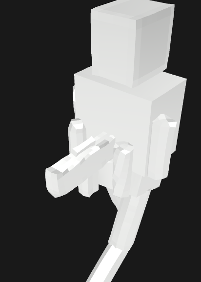

<div align="center">

# 🔷 Quadi AI

**Next-Generation 3D Asset Generation Pipeline**  
*Quad-Mesh First • Hierarchical Assembly • Ready-to-Animate*

<br>

<!-- Language Switcher Buttons -->
<a href="#english"></a>
<a href="#chinese"></a>
<a href="#japanese"></a>

<br><br>

[](https://opensource.org/licenses/MIT)
[](https://www.python.org/downloads/)
[](https://www.blender.org/)

</div>

---

## 📸 Showcase / 成果物ギャラリー

<div align="center">

| 1. AI Generated Texture (AIデザイン画) | 2. Quad-Mesh Hierarchical Soldier (兵士モデル) |
| :---: | :---: |
|  |  |
| *True PBR metallic shading* | *Socket-rigged assault rifle & walk cycle* |

<br>

### 🎮 Interactive 3D Preview / 3Dモデルプレビュー
👉 **[Open glTF Viewer to Inspect in 3D](https://gltf-viewer.donmccurdy.com/)**  
*(Open the link above and drag & drop `quadi_armed_soldier.glb` to watch the real-time walk animation in 360°!)*

📦 **[Download quadi_armed_soldier.glb directly](./quadi_armed_soldier.glb)**

</div>

---

<a id="english"></a>
## 🌐 English

### 💡 Why Quadi AI?
Most modern 3D generative models (e.g., TripoSR, Meshy) output monolithic "melted clay" meshes where weapons melt into hands and topology is broken with chaotic triangles.

**Quadi AI breaks this paradigm by adopting professional 3D artist workflows:**
1. **Hierarchical Assembly:** Weapons and armor are generated as independent hard-surface assets rigidly attached via **Bone Sockets**—never fused into the body mesh.
2. **Quad-Mesh Topology First:** Direct quadrangulation via clean edge-loop retopology, ensuring clean deformation during movement.
3. **True PBR Materials:** Physical material separation (Rubber suit, Gunmetal steel, Emissive optics) instead of flat vertex colors.
4. **Built-in Skeletal Animation:** Generates rigged `.glb` files with automatic skinning and walk-cycle loops ready for game engines.

### ⚡ Quick Start
```bash
git clone https://github.com/liushengluntailang-ctrl/Quadi-AI.git
cd Quadi-AI
pip install -r requirements.txt
python examples/run_soldier.py
```

---

<a id="chinese"></a>
## 🇨🇳 中文

### 💡 为什么选择 Quadi AI？
现有的 3D 生成模型通常生成单一粘连的“融化粘土”网格，武器与手臂融为一体，且三角面混乱无法用于动画。

**Quadi AI 彻底颠覆了这种妥协，完全模拟专业 3D 技术美术（TA）的工作管线：**
1. **分层装配（模块化分离）：** 武器和外装甲作为独立模型生成，通过**骨骼插槽（Weapon Socket）**刚体挂载在手部，绝不粘连融化。
2. **四边面拓扑优先（Quad-First）：** 规范的四边面布线与循环边，专为动画关节拉伸与形变而生。
3. **真实 PBR 物理材质：** 彻底告别劣质单一贴图，实现防弹衣、装甲、枪械钢铁与发光瞄具的独立分层着色。
4. **内置骨骼动画：** 导出自带骨骼蒙皮与战术行进动画（Walk Cycle）的 `.glb` 文件，可直接导入 Unity 或 UE5。

### ⚡ 快速开始
```bash
git clone https://github.com/liushengluntailang-ctrl/Quadi-AI.git
cd Quadi-AI
pip install -r requirements.txt
python examples/run_soldier.py
```

---

<a id="japanese"></a>
## 🇯🇵 日本語

### 💡 なぜ Quadi AI なのか？
既存の3D生成AIモデル（TripoSR、Meshyなど）の最大の問題点は、「すべてを一塊の溶けた粘土として出力してしまうこと」でした。銃と手がドロドロに癒着し、エッジは丸まり、三角形ポリゴンの嵐によって関節を曲げた瞬間に破綻します。

**Quadi AI は、プロの3Dアーティストの制作思想をコードで再現します：**
1. **階層型アセンブリ（パーツ完全分離）：** 人体、装甲、武器を独立パーツとして生成し、右手ボーンの**「ウェポンソケット」**に剛体吸着。銃が手に溶けることは絶対にありません。
2. **四角形メッシュ（Quad）優先設計：** アニメーション時に皮膚が美しく伸縮する、エッジループの整ったクワッドトポロジーを採用。
3. **本格PBRマテリアルの分離：** ラバースーツ、ガンメタル装甲、黒染めスチール銃、発光ドットサイトを素材ごとに完全分離シェーディング。
4. **歩行アニメーション内蔵：** 骨格の自動ウェイト紐付けと歩行ループが最初から焼き込まれた `.glb` を書き出すため、ゲームエンジンですぐに動かせます。

### ⚡ クイックスタート
```bash
git clone https://github.com/liushengluntailang-ctrl/Quadi-AI.git
cd Quadi-AI
pip install -r requirements.txt
python examples/run_soldier.py
```

---

## 🎯 Use Cases / 适用场景 / 活用シーン

### 1. 🎮 Indie Game Dev (Unity / Unreal Engine 5)
- **EN:** Stop waiting for 3D modelers. Generate rigged, animated NPCs and weapons directly into `.glb` format, ready to drop into Unity or UE5.
- **ZH:** 独立游戏开发者的福音。直接生成自带骨骼与行走动画的 NPC 与武器，一键导入 Unity 或 UE5。
- **JA:** インディーゲーム開発に。リグと歩行モーションが入ったキャラクターや武器を即座に生成し、UnityやUnreal Engineにドラッグ＆ドロップで即座に投入可能。

### 2. 🌐 WebGL & Metaverse (Three.js / VRChat / Web)
- **EN:** Clean quad topology means lower polycount and zero rendering artifacts on Web browsers and VR devices.
- **ZH:** 规范的四边面布线带来极小的文件体积与超高渲染性能，完美适配网页端 Three.js 与 VR 场景。
- **JA:** メタバース・Web3Dに。整った四角形メッシュによりファイル容量が抑えられ、Three.jsやVR機器でも軽快に動作。

### 3. 🛠️ Blender Artists & 3D Prototyping
- **EN:** No melted clay. Quadi outputs structured parts that artists can actually open in Blender to edit modifiers, tweak bones, and customize materials.
- **ZH:** 告别不可编辑的废案。Quadi 输出结构清晰的分层文件，美术师可在 Blender 中直接调整骨骼、修改器与材质。
- **JA:** プロのプロトタイピングに。粘土の塊ではなく階層パーツとして出力されるため、Blenderで開いて手作業での微調整や追加モデリングが容易。

---

## 📊 Comparison / 对比 / 既存AIとの比較

| Feature / 特性 | ❌ Traditional 3D AI (TripoSR / Meshy) | 🔷 Quadi AI |
| :--- | :--- | :--- |
| **Topology (トポロジー)** | Chaotic triangles (破綻した三角面) | **Clean Quads / Edge-loops (整流四角面)** |
| **Weapons & Gear (装備)** | Fused & melted into hands (手に癒着・溶融) | **Rigid Socket Attachment (独立ソケット結合)** |
| **PBR Shading (質感)** | Flat single texture (安っぽい単一テクスチャ) | **Decoupled Materials (素材ごとの完全分離)** |
| **Animation (動き)** | Static / Breaks when bent (静止 / 曲げると破綻) | **Built-in Walk Cycles (歩行アニメーション内蔵)** |
| **Editability (編集性)** | Impossible to edit (手直し不可能) | **100% Modifiable in Blender (完全手直し可能)** |

---

## 🗺️ Roadmap / 路线图 / ロードマップ

- [x] **v0.1:** Core Hierarchical Assembly & Socket Rigging Pipeline
- [x] **v0.2:** Headless Blender 4.2 Automation & PBR Material Separation
- [ ] **v0.3:** Autonomous LLM Tool-Use (Dynamic Modeling from Arbitrary Prompts)
- [ ] **v0.4:** Multi-view FLUX.1 Texture Projection & Normal Map Baking
- [ ] **v0.5:** ComfyUI Node Integration & Web UI

---

## 📄 License
Licensed under the [MIT License](LICENSE).
